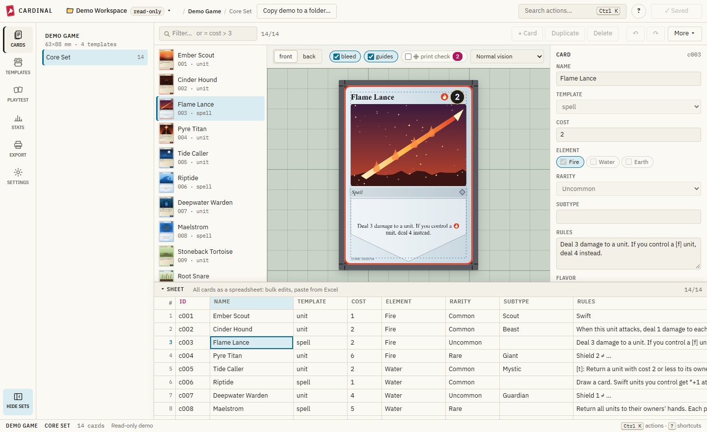
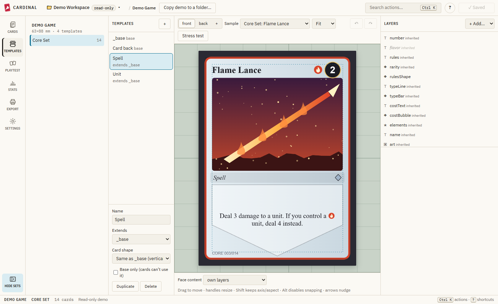
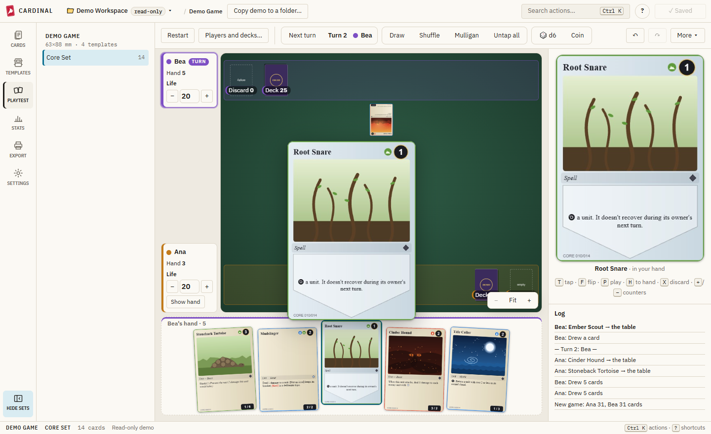

<p align="center"></p>

# Cardinal: Card Maker

Design trading card games on your own computer: card templates, a card spreadsheet with live preview, statistics, a playtest table for up to four players, and print-ready PDFs for a print shop.

No account, no internet, nothing to install. Your games are plain folders of JSON, CSV and image files that open in Excel and work with git.



## What it does

- **Any card game.** You define the fields (cost, type, rarity…), card size, bleed, icons and keywords per game. Nothing in the app assumes a particular game.
- **Templates:** a visual editor with layers (images, text, shapes) bound to fields, show-if rules, text that fits shaped boxes, templates that extend other templates, front and back faces, and vertical and horizontal cards in one set.
- **Cards:** a spreadsheet that copies and pastes with Excel, CSV and XLSX import and export, checks for invalid values, find and replace, `[fire]` icons in text, and keywords that add their reminder text.
- **One renderer:** the preview, PNG images, PDFs and Tabletop Simulator sheets are all drawn the same way, so what you see is what gets printed.
- **Statistics:** counts and histograms by any field, with filters.
- **Playtest:** 1 to 4 players taking turns at one screen. Hands stay hidden between turns, and decks lie on the table as piles you can move. Also deck building, exact draw odds, playtest snapshots that list what changed since the last print, and a gallery page playtesters can rate cards on.
- **Printing:** PDF sheets with bleed, crop marks, backs and card counts, CMYK output (built in, or with your print shop's ICC profile), a print check for things that tend to go wrong, a cost planner, and a one-page test print for checking scale, cutting and colour before a big order.

| Templates | Playtest |
| --- | --- |
|  |  |

## Download and run

Download the zip for your computer from the [latest release](../../releases/latest) and unzip it. There is nothing to install: the program inside is the whole app.

| Computer | Cardinal (its own window) | Cardinal Browser (in your browser) |
| --- | --- | --- |
| Windows (64-bit) | `cardinal-windows-x64.zip` | `cardinal-browser-windows-x64.zip` |
| Mac with Apple silicon (M1 and later) | `cardinal-mac-apple-silicon.zip` | `cardinal-browser-mac-apple-silicon.zip` |
| Mac with an Intel processor | `cardinal-mac-intel.zip` | `cardinal-browser-mac-intel.zip` |
| Linux (64-bit) | `cardinal-linux-x64.zip` | `cardinal-browser-linux-x64.zip` |

- **Cardinal** opens in its own window, like any other app, and quits when you close the window. The window is drawn by Microsoft Edge, which is part of Windows, or by Chrome or Edge on a Mac or Linux if one is installed (otherwise Cardinal opens in your default browser). It uses its own profile, separate from your own browsing. On a Mac it is `Cardinal.app`.
- **Cardinal Browser** opens in your default browser instead, for example Firefox, Safari or Zen. A small window opens next to it: keep it open while you work and close it to stop.

The programs aren't signed with a paid certificate, so the first start needs one extra step:

- **Windows:** if *Windows protected your PC* appears, click **More info**, then **Run anyway**.
- **Mac:** macOS says it can't check the program for malware. Click **Done**, open **System Settings → Privacy & Security**, scroll down, click **Open Anyway**, then start the program again. (Or run `xattr -dr com.apple.quarantine` on the unzipped folder in Terminal.)

With Cardinal Browser, any modern browser works: Chrome, Edge, Firefox, Safari, Zen, and others. Chrome and Edge open folders with your system's own folder picker; in the others the app shows its own folder picker, and the program reads and writes the files for it. Everything stays on your computer: the program only answers your own browser, and the app makes no internet connections.

New here? Open the built-in **demo**, then read the [user guide](docs/user-guide.md).

## Building from source

You need [Node.js](https://nodejs.org) 25 or newer.

```sh
npm install
npm run dev        # the app at http://localhost:5173 (add ?demo to open the demo)
npm test           # unit tests
npm run lint       # type check
npm run e2e        # browser tests (needs `npm run dev` running; see CLAUDE.md)
npm run app        # build, then run it like Cardinal Browser (add -- --app for its own window)
npm run package    # build both downloads for this computer into release/
```

On Windows, `start-cardinal.bat` installs and starts the development version with a double-click.

How the code is organised: [docs/architecture.md](docs/architecture.md). Why things are the way they are: [docs/decisions.md](docs/decisions.md).

### Making a release

Versions follow [semantic versioning](https://semver.org) and are listed in [CHANGELOG.md](CHANGELOG.md).

1. Set the new version in `package.json` (`npm version 0.2.0 --no-git-tag-version` also updates `package-lock.json`), and describe it under `## [0.2.0] - <date>` in `CHANGELOG.md`.
2. Commit, then tag and push:

   ```sh
   git tag v0.2.0
   git push origin main v0.2.0
   ```

3. The release workflow checks that the tag matches `package.json` and the changelog, builds both downloads on Windows, Mac (Apple silicon and Intel) and Linux, checks that each starts, and makes a **draft** release with the zips and the changelog section as notes. Check it on the Releases page and publish it. A tag with a dash, such as `v0.2.0-beta.1`, becomes a pre-release.

## Licence

[MIT](LICENSE). The app bundles the IBM Plex fonts (SIL Open Font License 1.1) and a few MIT, BSD and ISC libraries; every download includes their licences in `THIRD-PARTY LICENSES.txt`.
